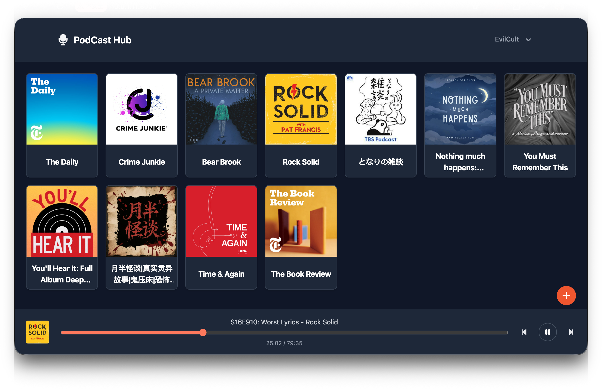

# Podcast Hub 📻

[](https://github.com/evilcult/podcast-hub)

[English](../README.md)

Podcast Hub 是一个自托管的极简播客代理服务器与网页播放器，基于 **Svelte 5**、**SvelteKit** 和 **SQLite** 构建。

它为播客爱好者提供一个无缝的订阅与收听平台：绕过上游源的跨域（CORS）与防盗链限制，为网络受限环境和极简设备提供**实时音频转码**，并在多设备间记住播放进度。

---

## ✨ 核心特性

- **➕ 一键订阅，支持 Apple Podcasts**
    - 直接粘贴标准 Podcast RSS Feed 即可订阅。
    - Apple Podcasts 链接（如 `https://podcasts.apple.com/...`）会自动经 iTunes API 解析为真实的 RSS 订阅源。

- **🔄 实时音频转码 (`/api/transcode`)**
    - 基于系统级 `ffmpeg` / `ffprobe`。
    - 四档音质，可在设置里按用户切换：
        | 档位            | 采样率   | 码率     | 声道                    |
        | --------------- | -------- | -------- | ----------------------- |
        | 流畅 (Smooth)   | 32 kHz   | 48 kbps  | 单声道                  |
        | 标准 (Standard) | 44.1 kHz | 96 kbps  | 立体声                  |
        | 高音质 (High)   | 44.1 kHz | 128 kbps | 立体声                  |
        | 原始 (Original) | —        | —        | —（源音频直通，不转码） |
    - **用 `?pos=` seek 与续播**：客户端不在流上 seek。每次 seek 或续播都带 `?pos=<秒数>` 重新加载，服务器从该位置开始转码。这比浏览器对转码流发 Range 请求可靠得多。

- **🖼️ 音频与图片代理**
    - **音频代理 (`/api/audio`)**：突破部分播客托管商的防盗链与非 HTTPS 限制，完整支持 `HTTP Range` 续传。
    - **封面代理 (`/api/image`)**：解决第三方封面图的跨域防盗链问题，内置 1 天浏览器缓存（`Cache-Control`），降低上游带宽消耗。

- **💾 播放进度与续播**
    - 播放器每 **10 秒**自动把当前进度（`pos`）同步到 SQLite。
    - 下次点开任意单集，秒级恢复到上次的位置，**跨设备无缝续播**。

- **📜 无限滚动加载**
    - 单集列表用 `IntersectionObserver` 懒加载分页，即使订阅有数千集的播客，界面依然极速响应。

- **👤 多用户账号**
    - 首次运行会 seed 一个默认管理员账号——**用户名 `admin`，密码 `123456`**。首次登录后请在设置里改密码。

- **🔁 自动刷新订阅**
    - Docker 镜像内置 cron，每 **4 小时**重新抓取全部订阅（`/api/refresh`），新单集自动出现，无需手动刷新。

- **🤖 极简设备扁平通道 (FlatAPI)**
    - 为老旧设备、智能手表、极简播放终端提供的扁平化、无嵌套精简 API（`/flatapi/...`）。
    - 返回的单集音频地址自动封装为设备转码配置（**32 kHz / 48 kbps / 单声道**），省流量、兼容性好。
    - 设计上无鉴权：永远读取管理员（uid 1）的订阅、收藏与历史。如果你不接受这一点，不要把 FlatAPI 暴露到公网。

---

## 🛠️ 技术栈

- **前端**：Svelte 5 (Runes)、Tailwind CSS、Flowbite-Svelte
- **后端**：SvelteKit（`@sveltejs/adapter-node` 服务端构建）
- **数据库**：SQLite（`better-sqlite3`），WAL 模式，强制外键约束
- **核心工具**：FFmpeg & FFprobe（解码、分析、流式实时转码）
- **部署**：Docker（镜像内置 cron 与 FFmpeg 环境）

---

## 🚀 快速开始 (Docker)

`main` 分支每次更新都会自动构建多架构镜像（`linux/amd64`、`linux/arm64`）并发布到 GitHub Container Registry：

```sh
docker run -d \
  --name podcast-hub \
  -p 3000:3000 \
  -v ./data:/app/data \
  -e PUBLIC_API_URL=http://你的服务器:3000/api \
  -e PUBLIC_HOST=http://你的服务器:3000 \
  --restart unless-stopped \
  ghcr.io/evilcult/podcast-hub:latest
```

然后访问 `http://你的服务器:3000`，用 `admin` / `123456` 登录。

> ⚠️ 必须挂载**整个 `data/` 目录**，不要只挂载单个数据库文件——SQLite WAL 模式下 `database.db`、`database.db-wal`、`database.db-shm` 三件套缺一不可，单文件挂载会把它们拆散。

### 自己构建镜像

```sh
docker build -t podcast-hub .
```

---

## ⚙️ 配置

| 变量          | 是否必填 | 说明                                                                                                                                                                                |
| ------------- | -------- | ----------------------------------------------------------------------------------------------------------------------------------------------------------------------------------- |
| `PUBLIC_HOST` | 否       | 服务器的公共访问地址，如 `http://你的服务器:3000`。用于拼 API / 转码地址等。当path不是根路径时使用,如`http://你的服务器:3000/podcarst`                                              |
| `PROXY_URL`   | 否       | 服务端 fetch（iTunes 查询、RSS、封面图、音频）的出站代理。空 = 直连；`socks5://127.0.0.1:1080` 直接指定代理；`https_proxy` 则读取 `https_proxy` 环境变量的值。`no_proxy` 依然有效。 |
| `JWT_SECRET`  | 否       | 会话 cookie 签名密钥。未设置时自动生成随机密钥并存入 `data/jwt_secret`（gitignored）。多实例共享同一 `data/` 目录时请显式设置。                                                     |
| `PORT`        | 否       | 监听端口，默认 `3000`。                                                                                                                                                             |

本地开发时，把 `.env.example` 复制为 `.env` 再改。注意 `.env` 只在本地 `vite dev` 下读取；Docker 部署请用容器环境变量。

---

## 💻 本地开发

开发环境须安装 **Node**, **FFmpeg** 并加入 `PATH`：

- **macOS**：`brew install node ffmpeg`
- **Linux (Ubuntu/Debian)**：`sudo apt-get install nodejs npm ffmpeg`

```sh
# 1. 安装依赖
npm install

# 2. 启动开发服务器（默认端口 5173）
npm run dev

# 3. 构建生产产物
npm run build

# 4. 本地预览构建产物
npm run preview
```

---

## 🔌 API 接口文档

详见 [API 接口文档](./API_DOCS_CN.md)（[English](./API_DOCS_EN.md)）。

---

## 🔌 TO-DO

- [x] 基础页面
- [x] 收藏功能
- [x] 历史记录 & 同步
- [x] 滚动加载
- [x] 一键订阅
- [x] FlatAPI:简化版API,针对Folo-Ai-Passport
- [x] 实时转码
- [x] 自动更新
- [x] 多用户系统
- [ ] 多语言支持
- [ ] 多主题切换
- [ ] YouTube转换Podcast
- [ ] 优化性能

---

## 📂 项目结构

```txt
/
├── .github/workflows/       # CI：多架构 Docker 镜像构建与发布
├── config/                  # 容器配置 (crontab、启动脚本)
├── data/                    # SQLite 数据库目录 (gitignored)
├── scripts/                 # 维护脚本
├── src/
│   ├── lib/
│   │   ├── components/      # 播放器及通用 UI 组件
│   │   ├── server/          # 仅服务端的代码：数据库、repos、转码、刷新
│   │   └── stores/          # Svelte 5 全局播放器状态
│   └── routes/              # SvelteKit 页面与 API 路由
│       ├── api/             # 网页 + 代理/转码 API
│       ├── flatapi/         # 设备端扁平 API
│       ├── radio/           # 播客页面
│       ├── fav/             # 收藏页面
│       ├── history/         # 历史页面
│       ├── settings/        # 设置页面
│       └── login/           # 登录页面
├── static/                  # 静态资源
├── Dockerfile               # 镜像构建 (Node 22 + FFmpeg)
└── .env.example             # 环境变量示例
```

---

## 许可证

本项目基于 MIT 许可证开源，详见 [LICENSE](../LICENSE) 文件。
