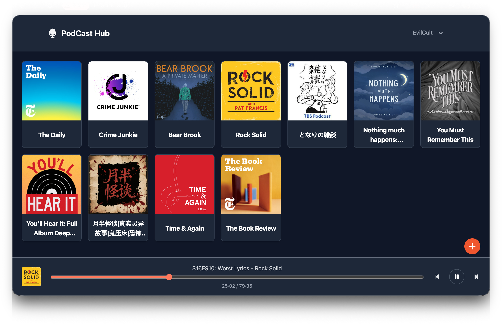

# Podcast Hub 📻

[](https://github.com/evilcult/podcast-hub)

[中文文档](./Docs/README-CN.md)

Podcast Hub is a self-hosted, minimal podcast proxy server and web player, built with **Svelte 5**, **SvelteKit**, and **SQLite**.

It gives podcast listeners a seamless place to subscribe and listen — working around upstream CORS and hotlink restrictions, serving **real-time audio transcoding** for bandwidth-constrained networks and minimal devices, and remembering playback progress across devices.

---

## ✨ Features

- **➕ One-click subscribe, with Apple Podcasts support**
    - Paste any standard podcast RSS feed to subscribe.
    - Apple Podcasts links (e.g. `https://podcasts.apple.com/...`) are resolved automatically via the iTunes API into their real RSS feeds.

- **🔄 Real-time audio transcoding (`/api/transcode`)**
    - Powered by system-level `ffmpeg` / `ffprobe`.
    - Four quality tiers, switchable per user in Settings:
        | Tier     | Sample rate | Bitrate  | Channels                          |
        | -------- | ----------- | -------- | --------------------------------- |
        | Smooth   | 32 kHz      | 48 kbps  | mono                              |
        | Standard | 44.1 kHz    | 96 kbps  | stereo                            |
        | High     | 44.1 kHz    | 128 kbps | stereo                            |
        | Original | —           | —        | — (source stream, no transcoding) |
    - **Seek & resume via `?pos=`**: the client never seeks on the stream itself. Every seek or resume reloads the stream with `?pos=<seconds>`, and the server starts the transcode from that position. This works reliably where browser Range requests against a transcoded stream do not.

- **🖼️ Audio & image proxy**
    - **Audio proxy (`/api/audio`)**: bypasses hotlink protection and non-HTTPS sources, with full `HTTP Range` support for direct playback.
    - **Image proxy (`/api/image`)**: fixes CORS/hotlink issues for cover art, with a 1-day browser cache (`Cache-Control`) to reduce upstream bandwidth.

- **💾 Playback progress & resume**
    - The player syncs the current position (`pos`) to SQLite every **10 seconds**.
    - Reopen any episode to resume exactly where you left off, on any device.

- **📜 Infinite scroll**
    - Episode lists load page by page via `IntersectionObserver`, so feeds with thousands of episodes stay fast.

- **👤 Accounts**
    - Multi-user with login. The first run seeds a default admin account — **username `admin`, password `123456`**. Change the password in Settings after your first login.

- **🔁 Automatic feed refresh**
    - The Docker image runs a cron job that re-fetches all subscribed feeds every **4 hours** (`/api/refresh`), so new episodes appear without manual action.

- **🤖 FlatAPI for minimal devices**
    - A flat, no-nesting API (`/flatapi/...`) for constrained clients — old devices, smartwatches, minimal playback terminals.
    - All episode URLs are automatically wrapped in the device transcode profile (**32 kHz / 48 kbps / mono**) to save bandwidth and maximize compatibility.
    - No authentication by design: it always reads the admin's (uid 1) subscriptions, favorites, and history. Do not expose FlatAPI publicly unless you are fine with that.

---

## 🛠️ Tech Stack

- **Frontend**: Svelte 5 (Runes), Tailwind CSS, Flowbite-Svelte
- **Backend**: SvelteKit with `@sveltejs/adapter-node`
- **Database**: SQLite (`better-sqlite3`), WAL mode, foreign keys enforced
- **Core tools**: FFmpeg & FFprobe (decoding, probing, streaming transcode)
- **Deployment**: Docker (cron and FFmpeg included in the image)

---

## 🚀 Quick Start (Docker)

Prebuilt multi-arch images (`linux/amd64`, `linux/arm64`) are published to GitHub Container Registry on every update to `main`:

```sh
docker run -d \
  --name podcast-hub \
  -p 3000:3000 \
  -v ./data:/app/data \
  -e PUBLIC_HOST=http://your-server:3000 \
  --restart unless-stopped \
  ghcr.io/evilcult/podcast-hub:latest
```

Then open `http://your-server:3000` and log in with `admin` / `123456`.

> ⚠️ Mount the **whole `data/` directory**, never a single database file — SQLite WAL mode keeps `database.db`, `database.db-wal`, and `database.db-shm` together, and mounting a single file will split them apart.

### Build the image yourself

```sh
docker build -t podcast-hub .
```

---

## ⚙️ Configuration

| Variable      | Required | Description                                                                                                                                 |
| ------------- | -------- | ------------------------------------------------------------------------------------------------------------------------------------------- |
| `PUBLIC_HOST` | No       | Public base URL of the server, e.g. `http://your-server:3000`. Used to build API / transcode URLs. When the path is not the root path, include it, e.g. `http://your-server:3000/podcast`. |
| `PROXY_URL`   | No       | Outbound proxy for all server-side fetches (iTunes lookup, RSS, cover art, audio). Empty = direct. `socks5://127.0.0.1:1080` for a direct proxy, or `https_proxy` to reuse the value of the `https_proxy` environment variable. `no_proxy` is honored. |
| `JWT_SECRET`  | No       | Secret for signing session cookies. If unset, a random secret is generated and stored in `data/jwt_secret` (gitignored). Set it explicitly if you run multiple instances sharing one `data/` directory. |
| `PORT`        | No       | Port the server listens on. Default `3000`.                                                                                                 |

For local development, copy `.env.example` to `.env` and adjust the values. Note that `.env` is only read under local `vite dev`; Docker deployments take configuration from the container environment instead.

---

## 💻 Local Development

Node and FFmpeg must be installed and on your `PATH`:

- **macOS**: `brew install node ffmpeg`
- **Linux (Ubuntu/Debian)**: `sudo apt-get install nodejs npm ffmpeg`

```sh
# 1. Install dependencies
npm install

# 2. Start the dev server (default port 5173)
npm run dev

# 3. Build for production
npm run build

# 4. Preview the production build
npm run preview
```

---

## 🔌 API Reference

See the [API Reference](./Docs/API_DOCS_EN.md) ([中文版](./Docs/API_DOCS_CN.md)).

---

## 🔌 TO-DO

- [x] Basic pages
- [x] Favorites
- [x] History & sync
- [x] Infinite scroll
- [x] One-click subscribe
- [x] FlatAPI: simplified API for Folo AI Passport
- [x] Real-time transcoding
- [x] Auto refresh
- [x] Multi-user system
- [ ] Multi-language support
- [ ] Multi-theme switching
- [ ] YouTube to Podcast conversion
- [ ] Performance optimization

---

## 📂 Project Structure

```txt
/
├── .github/workflows/       # CI: multi-arch Docker image build & publish
├── config/                  # Container config (crontab, entrypoint)
├── data/                    # SQLite database directory (gitignored)
├── scripts/                 # Maintenance scripts
├── src/
│   ├── lib/
│   │   ├── components/      # Player and shared UI components
│   │   ├── server/          # Server-only code: DB, repos, transcode, refresh
│   │   └── stores/          # Svelte 5 global player state
│   └── routes/              # SvelteKit pages and API routes
│       ├── api/             # Web + proxy/transcode API
│       ├── flatapi/         # FlatAPI for device clients
│       ├── radio/           # Podcast pages
│       ├── fav/             # Favorites page
│       ├── history/         # History page
│       ├── settings/        # Settings page
│       └── login/           # Login page
├── static/                  # Static assets
├── Dockerfile               # Image build (Node 22 + FFmpeg)
└── .env.example             # Example environment configuration
```

---

## License

This project is licensed under the MIT License — see the [LICENSE](./LICENSE) file.
